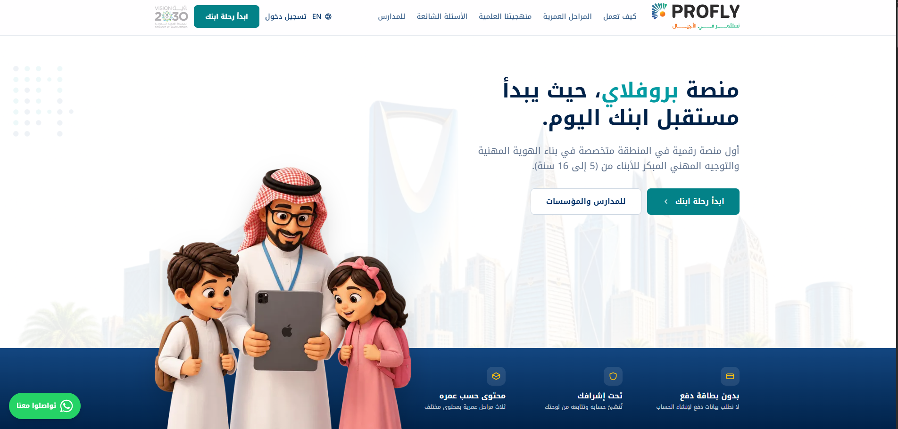
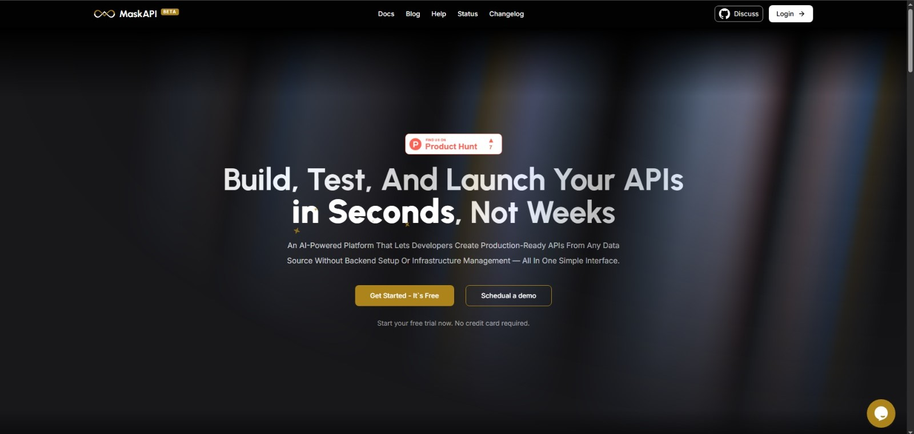
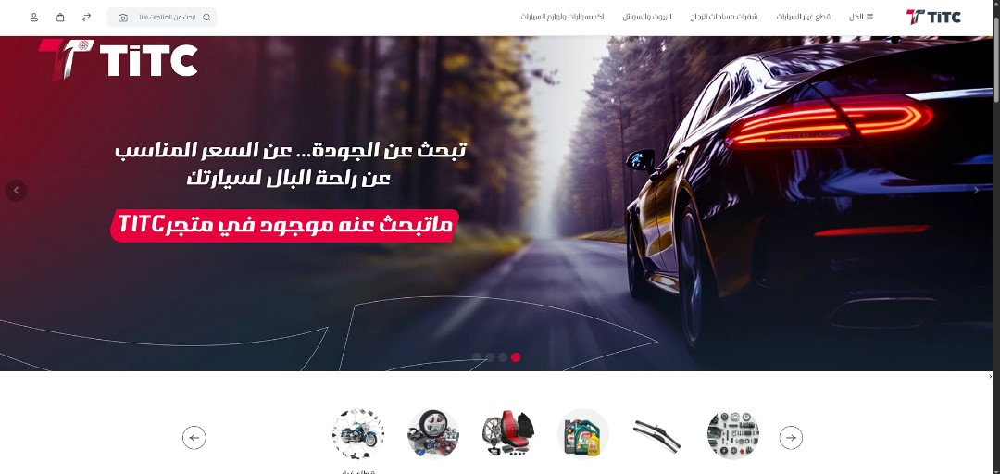
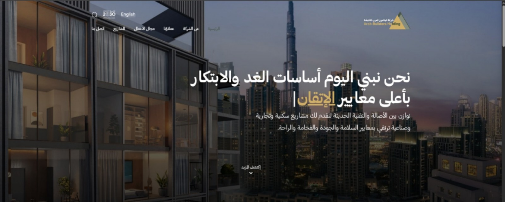
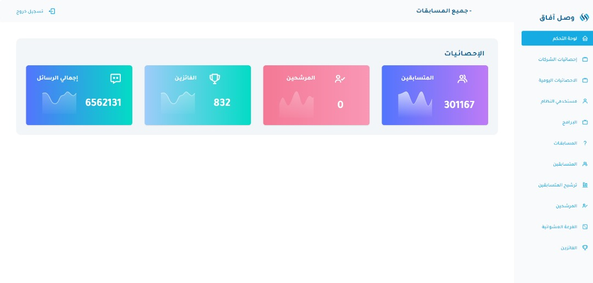
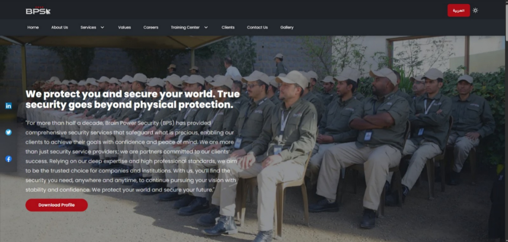
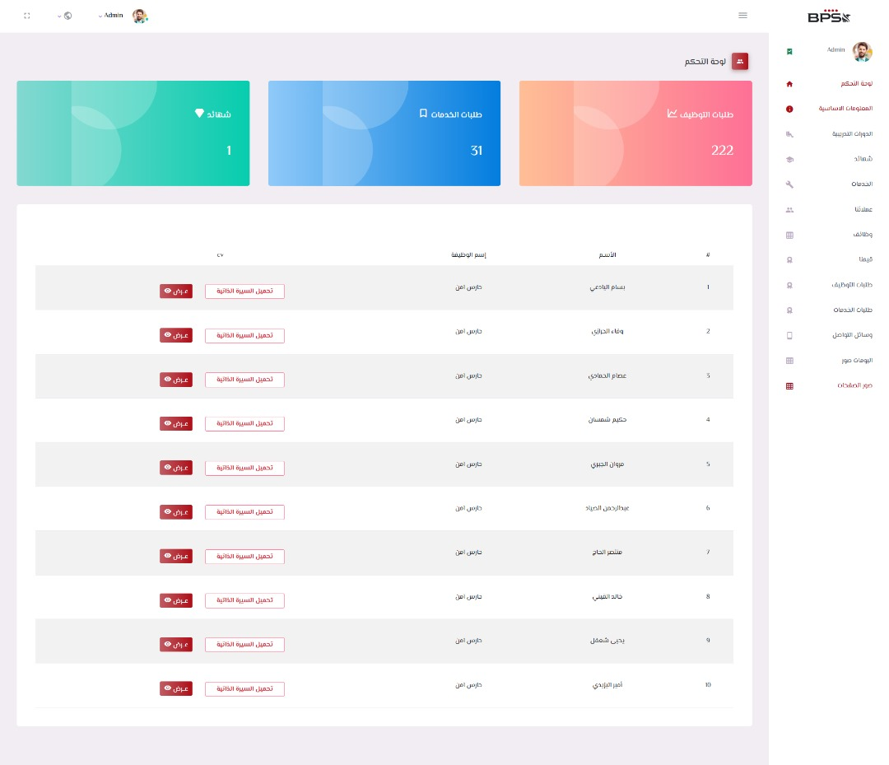
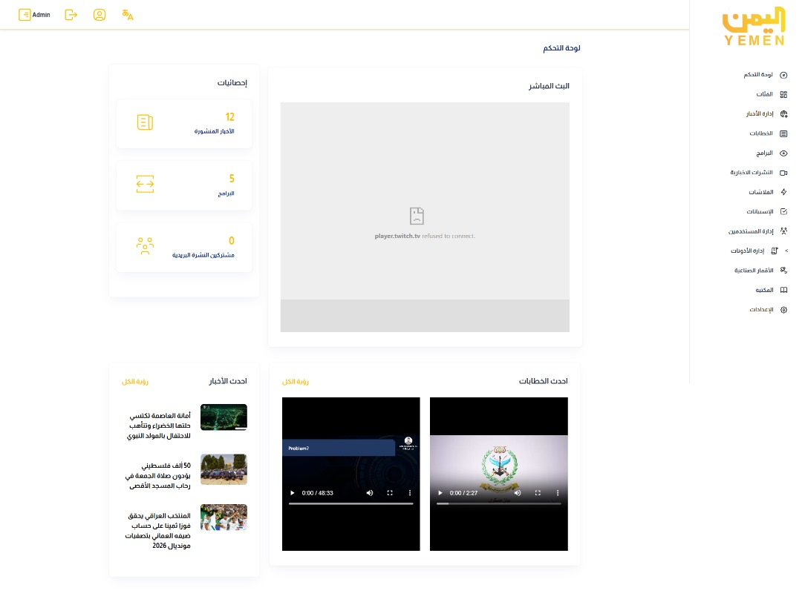
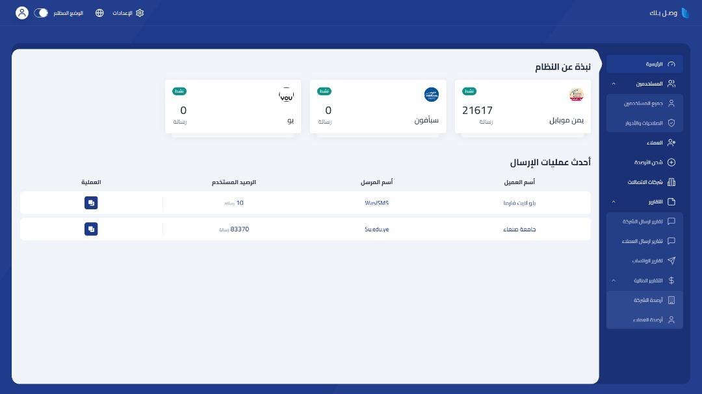
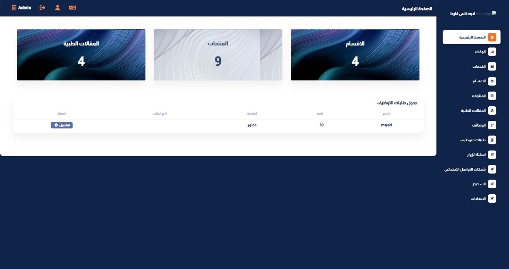

## Hey 👋, This is Majed 👨🏻‍💻!

  
I'm a <b>Full-Stack & Backend Developer</b> with <b>4+ years of experience</b> building web applications and platforms from the ground up, as well as developing and optimizing existing systems using <b>PHP and Laravel</b>.

  
My primary focus is <b>Backend Engineering</b>, including RESTful APIs, authentication and authorization, database design and optimization, background jobs, and automated testing 🧪.

  
On the frontend, I work with <b>Vue.js, JavaScript, and Tailwind CSS</b>, with additional experience in React.js, Next.js, and TypeScript.

  
I also have hands-on experience integrating <b>AI-powered features</b>, payment gateways, messaging services, and video streaming, alongside CI/CD, server deployments, and cloud infrastructure. Currently, I'm developing an enterprise CRM at <b>Elevenz</b>, and previously built the backend of <b>ProFly</b> from the ground up.

 

<!--## ⌨️ Feeding 
 -->

## 🚀 Featured Projects

> Some projects are client-owned or private. Selected details and screenshots are included to showcase my contributions.

---

### 1) Eleven​z CRM — Enterprise CRM System

Contributing to the development and optimization of an enterprise CRM system, working across frontend and backend components. Developed an AI-powered quotation import feature that analyzes PDF, Word, and Excel documents, including scanned PDFs using OCR, with background processing through queues and jobs.

**Highlights:**
- Reduced database queries for a measured contract API workflow from 1,818 to 16.
- Developed AI-powered document processing using OpenRouter and OCR.
- Improved application architecture, database queries, and API performance.

**Stack:** Laravel + Vue.js + Tailwind CSS + MySQL + MariaDB + OpenRouter + OCR + Queues & Jobs.

<!--  -->

---

### 2) ProFly — Educational Platform

Built the platform's backend from the ground up, supporting four account types: students, parents, career mentors, and schools or organizations, with four role-based dashboards and educational content management.

Integrated payment gateways, messaging and email services, AI-powered features, and cloud infrastructure to support the platform's core workflows.

**Highlights:**
- Integrated production payment gateways: Moyasar, Tabby, and Tamara.
- Implemented invoice generation and QR codes aligned with ZATCA requirements.
- Integrated an AI-powered assistant and text-to-speech functionality.
- Integrated Cloudflare Stream for high-quality video hosting and delivery.
- Established testing and deployment workflows using GitHub Actions and Laravel Forge.

**Stack:** Laravel + Livewire + MySQL + Moyasar + Tabby + Tamara + Dreams SMS + Cloudflare Stream + AI Integration + GitHub Actions.

**Links:** [Official Website](https://profly.tech/)

<!--  -->

---

### 3) MaskAPI Platform (SaaS)
A SaaS platform that helps developers and businesses customize API response formats for endpoints.  
**Stack:** Next.js (Frontend) + Laravel (Admin Panel & Backend)  
**Links:** Live: [Demo](https://maskapi.dev/)

---

### 4) Automotive Spare Parts E-Commerce (Bagisto)
Configured and customized a full-featured Bagisto e-commerce platform, redesigned the storefront, and deployed with full testing.  
**Stack:** Laravel + Vue.js + Bagisto  
**Links:** Live: [Demo Store](https://titcparts.com/)

---
### 5) Benaa Organization — Admin Manara Dashboard + APIs + AI Integration
Built an SPA admin dashboard (Laravel/Livewire + Flux UI) with secure REST APIs, optimized database + RBAC, and AI integration (prompt engineering) to improve performance and UX.  
**Stack:** Laravel (Backend) + Admin Dashboard  

---

### 6) Arab Builders Holding — Company Website
Company website showcasing information, services, and projects with a responsive UI.  
**Stack:** Laravel (Backend) + Tailwind CSS (UI)  
**Links:** Live: [Demo](https://abcholding.com.sa/)

---

### 7) Yemen TV — SMS Competition Admin Dashboard
Admin dashboard to manage SMS competitions: reporting & filtering over 6M+ records, participant draws, winners, and lottery management.  
**Stack:** Laravel  

---

### 8) Orient Co. — CMS + Jobs & Applications
Company website with a CMS, job listings, and an application flow.  
**Stack:** Laravel  
**Links:** Live: [Demo Website](https://bps-sec.com)

---

### 9) Yemen TV (Yemen Satellite Channel) — Admin Dashboard
Admin panel built to manage the channel’s website content (news, videos, categories, and publishing workflow).  
**Stack:** Laravel  

---

### 10) VAS Platform — Admin Dashboard (Value-Added Services)
Admin dashboard for managing VAS operations, including customer accounts, service packages, 
and messaging workflows with telecom integrations.  
**Stack:** Laravel  

---

### 11) LightNas Pharma — Website + Blog/Comments (Dashboard Contribution)
Pharmaceutical company website showcasing products/services/departments with blogs and a commenting system; my contribution included building the dashboard.  
**Stack:** Laravel  

 

## ⚙️Tech Stack & Tools

- ### Programming Languages:
<code>  </code>
<code>  </code>
<code>  </code>
<code>  </code>

 

- ### Frontend:
<code>  </code>
<code>  </code>
<code>  </code>
<code>  </code>
<code>  </code>
<code>  </code>
<code>  </code>
<code>  </code>
<code>  </code>
<code>  </code>
<code>  </code>
<code>  </code>
<code>  </code>

 

- ### Backend:
<code>  </code>
<code>  </code>
<code>  </code>
<code>  </code>
<code>  </code>
<code>  </code>
<code>  </code>
<code>  </code>
<code>  </code>
<code>  </code>
<code>  </code>
<code>  </code>
<code>  </code>

 

- ### AI & LLMs:
<code>  </code>
<code>  </code>

 

- ### Development:
<code>  </code>
<code>  </code>
<code>  </code>
<code>  </code>
<code>  </code>
<code>  </code>
<code>  </code>
<code>  </code>
<code>  </code>
<code>  </code>
<code>  </code>

 

- ### Testing & QA:
<code>  </code>
<code>  </code>

 

- ### DevOps & CI/CD:
<code>  </code>
<code>  </code>
<code>  </code>
<code>  </code>
<code>  </code>
<code>  </code>
<code>  </code>
<code>  </code>

 

- ### Task Management & Team Collaberation: 
<code>  </code>
<code>  </code>
<code>  </code>

 

## 📈 My Journey

  
  
   
   
